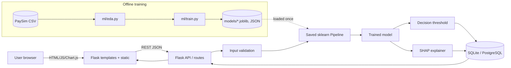
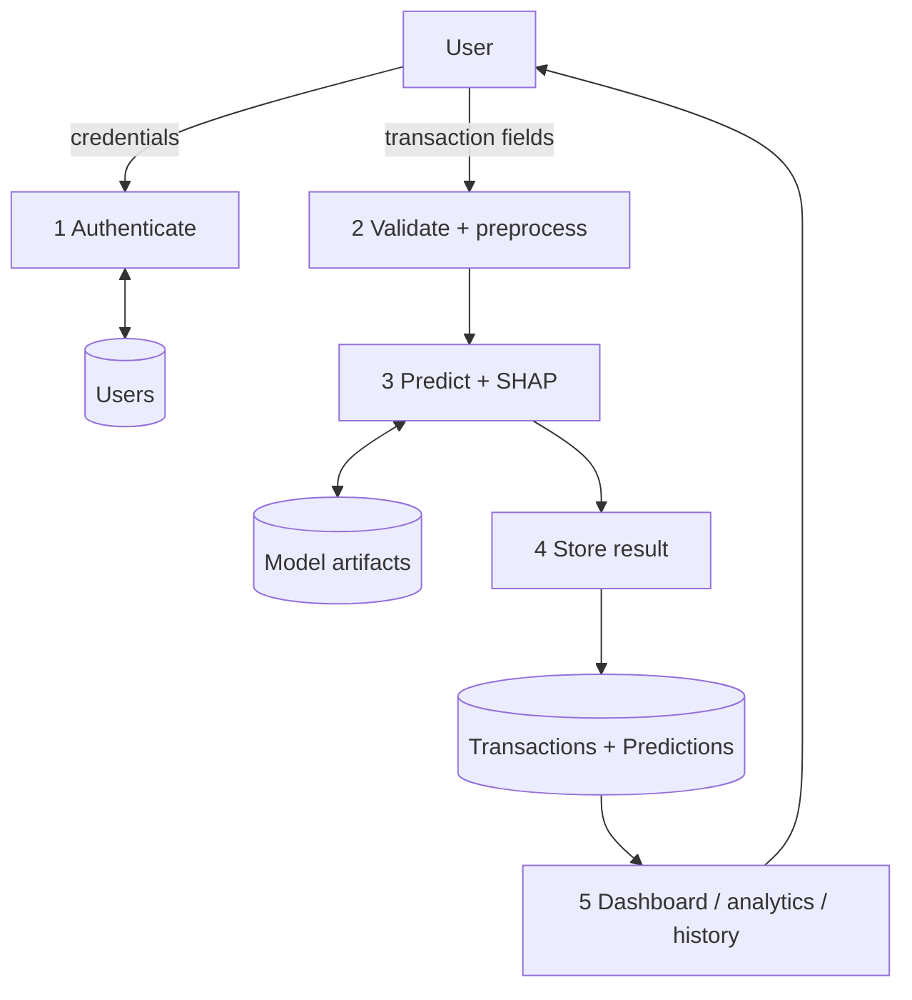
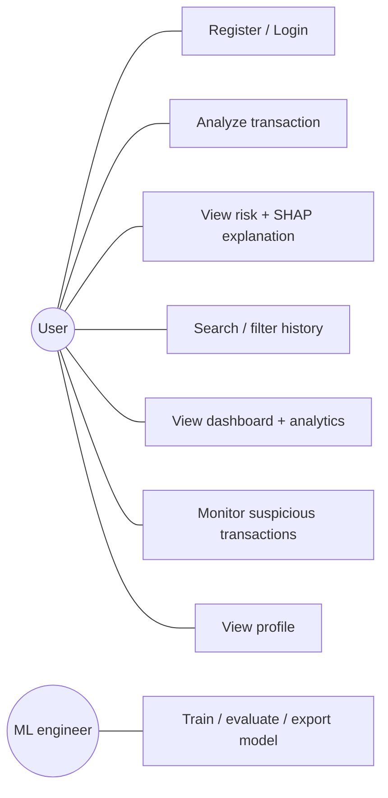
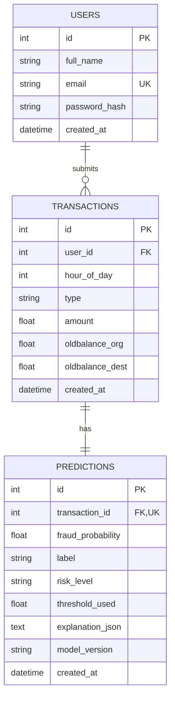
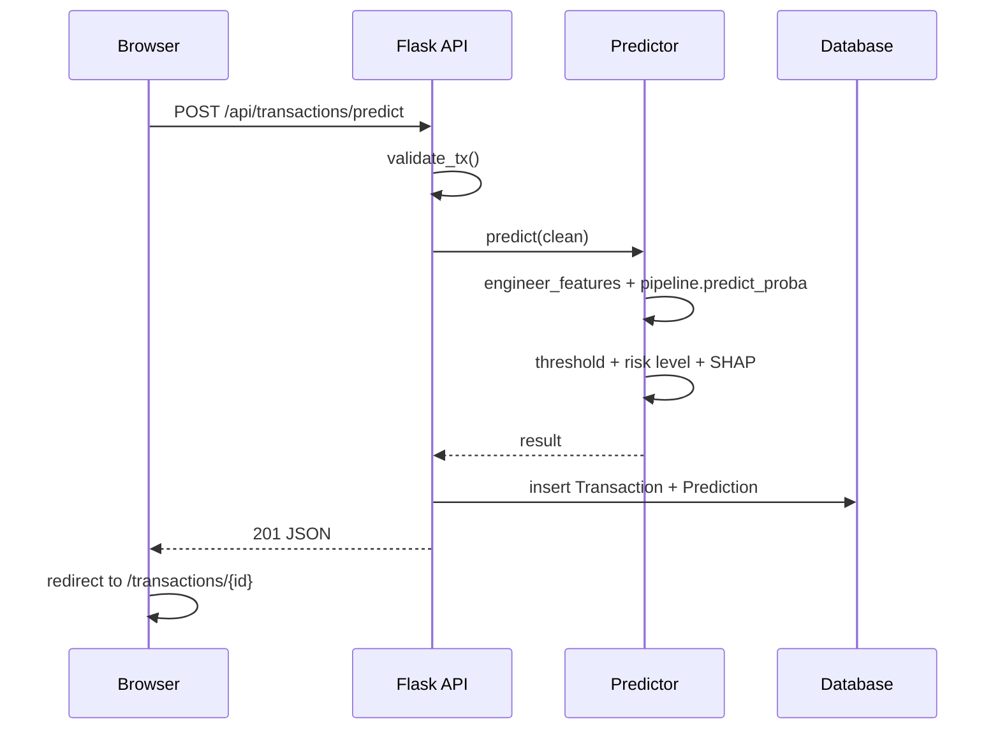

# Diagrams (Mermaid - render in VS Code with "Markdown Preview Mermaid Support", GitHub, or mermaid.live)

## System architecture

## Data flow diagram (Level 1)

## Use case diagram

## ER diagram

## Sequence: analyze a transaction

